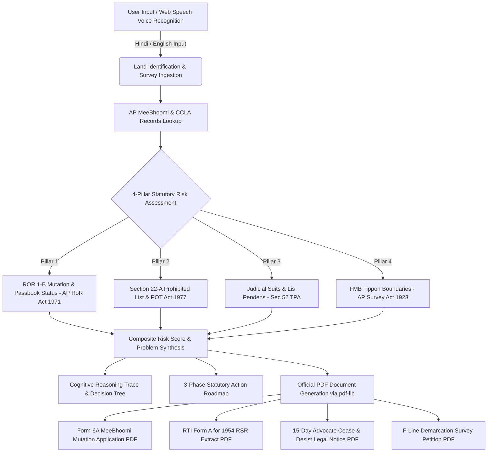

# LandNyaya AP • Andhra Pradesh Land Title & Statutory Dispute Intelligence Agent

> **AI-Powered Revenue Law & Title Verification Engine for Andhra Pradesh**  
> Synthesizing **MeeBhoomi ROR 1-B Khata**, **Gram Adangal**, **Registration Act Section 22-A Prohibitions**, **FMB Tippon Boundary Demarcations**, and generating **official, submission-ready legal PDFs** in under 10 seconds.

---

## 🏛️ Executive Summary & Problem Statement

Land records and property conveyances across **Andhra Pradesh** face distinct statutory complexities:
1. **MeeBhoomi Mutation Delays**: Uncertified Form-6A entries where ownership is not updated in the ROR 1-B Khata, leaving titles vulnerable to administrative challenges under *Section 5 & 5-B of the AP Rights in Land and Pattadar Pass Books Act, 1971*.
2. **Section 22-A Prohibited Properties Refusal**: Land classified as *Assigned (D-Patta) under POT Act 1977*, *Endowment / Devasthanam*, *Waqf*, or *Government Poramboke* where any conveyance is **null and void ab initio** under *Section 22-A of the Registration Act, 1908*.
3. **Boundary Encroachment & Demolished Field Bunds**: Demolition of boundary bunds (*వరవ గట్లు*) and boundary marker displacement requiring statutory intervention under *Sections 9 & 10 of the AP Survey and Boundaries Act, 1923*.
4. **Litigation & Stay Orders**: Concealed civil suits, *Lis Pendens (Section 52 TPA)*, and *Order 39 interim injunctions*.

**LandNyaya** bridges the gap between raw revenue data, legal statutes, and actionable remedies by automating statutory auditing, risk calculation, and official document drafting.

---

## ⚡ Agentic Flow & System Architecture



---

## ⚖️ The 4 Statutory Pillars

| Pillar | Statutory Authority | Key Scrutiny & Red Flags |
| :--- | :--- | :--- |
| **1. MeeBhoomi 1-B Mutation** | *AP Rights in Land & Pattadar Pass Books Act, 1971 (Sec 5 & 5B)* | Verifies Column 12 (Pattadar) vs Column 13 (Enjoyer) in Adangal; checks Form-6A token status and 30-day statutory notice compliance. |
| **2. Section 22-A Prohibitions** | *Registration Act, 1908 (AP Sec 22-A) & POT Act 1977 (Act 9/1977)* | Detects prohibited D-Patta assigned land, Endowment temples, Waqf board, and Gram Kantham / Poramboke where registrations are void. |
| **3. Judicial Dockets & Lis Pendens** | *Transfer of Property Act, 1882 (Sec 52) & CPC 1908 (Order 39)* | Screens pending civil suits, temporary stay orders, Caveat petitions, and Section 5-B RDO appeal proceedings. |
| **4. FMB Boundaries & Bunds** | *AP Survey & Boundaries Act, 1923 (Sec 9 & 10)* | Analyzes FMB Tippon ladders, missing survey stones, and neighbor encroachments requiring Tatkal F-Line survey. |

---

## 🎯 Instant Judge / Evaluator Demo Mode

Judges and evaluators can test the entire workflow with **zero typing in under 3 seconds** using the pre-configured scenarios:

1. **⚡ Case 1: 15-Cent Boundary Encroachment** (`Survey No. 142/3A, NTR Vijayawada`)
   - *Issue*: Adjoining owner demolished field bund (*Gattu*) and encroached 15 cents.
   - *Outcome*: High Risk Score (74) $\rightarrow$ Generates **15-Day Advocate Legal Notice** + **Tatkal F-Line Demarcation Petition**.
2. **⚡ Case 2: Section 22-A Prohibited D-Patta Land** (`Survey No. 88/1, Visakhapatnam`)
   - *Issue*: Assigned land under POT Act 1977; sale deed rejected by Sub-Registrar.
   - *Outcome*: Critical Risk Score (92) $\rightarrow$ Generates **RTI Form A for 1954 RSR true copy** + **22-A De-notification Representation**.
3. **⚡ Case 3: Form-6A MeeBhoomi Mutation Delay** (`Survey No. 204/B, Guntur`)
   - *Issue*: Form-6A application pending for 75 days without Form-VIII certification.
   - *Outcome*: High Risk Score (68) $\rightarrow$ Generates **Form-6A Compliance Demand** + **Section 5-B Statutory RDO Appeal**.
4. **⚡ Case 4: Clean Title Pre-Purchase Verification** (`Survey No. 45/2, Tirupati`)
   - *Issue*: Pre-purchase verification for 3.10 Acres of Ryotwari Dry land.
   - *Outcome*: Safe Title Score (12, Green) $\rightarrow$ Generates **Clean Title Certificate** and Title Chain report.

---

## 🎙️ Browser Voice Input (Web Speech Recognition)

- **Native Web Speech API**: No third-party audio streaming required; processes speech locally in the browser.
- **Bilingual Speech Recognition**: Seamlessly recognizes Hindi (`hi-IN`) and English (`en-IN`).
- **Intelligent Speech Parser**:
  - *Spoken Survey Numbers*: *"142 बटा 3 ए"*, *"142 slash 3A"*, *"88/1"* $\rightarrow$ normalized into `142/3A`, `88/1`.
  - *Spoken District Names*: *"विजयवाड़ा"*, *"गुंटूर"*, *"विशाखापत्तनम"*, *"तिरुपति"* $\rightarrow$ mapped to the 26 Andhra Pradesh districts.
  - *Smart Combined Speech Bar*: Speak *"सर्वे नंबर 142 बटा 3A जिला विजयवाड़ा"* to auto-fill both fields in one click.

---

## 📄 Official PDF Generation Engine (`pdf-lib`)

LandNyaya generates official, formatted legal drafts ready to print or submit:

1. **Form-6A MeeBhoomi Mutation Application**: Addressed to the Tahsildar & Joint Sub-Registrar with applicant metadata, Khata number, passbook UID, and statutory grounds.
2. **RTI Form A Application**: Under Section 6(1) & 7(1) of the RTI Act 2005 for certified extracts of 1954 Resurvey Settlement Register (RSR) and FMB Tippon.
3. **15-Day Advocate Cease & Desist Legal Notice**: Served via India Post RPAD to vacate unauthorized boundary encroachments and rebuild field bunds.
4. **F-Line Demarcation Survey Petition**: Under Sections 9 & 10 of the AP Survey & Boundaries Act 1923 for DGPS boundary measurement and stone marker erection.

### Document Standards Included:
- **High-contrast Revenue Draft Header** with dynamic tracking reference numbers.
- **Pre-formatted Court Fee / Revenue Stamp Box** (`[ AFFIX COURT FEE STAMP RS. 10/- ]`).
- **2-Column Property & Applicant Metadata Schedule Box**.
- **Mandatory Statutory Enclosures Checklist** (`[X] Registered Deed`, `[X] 1-B Khata`, `[X] CFMS Challan`).
- **Legal Signature & Counsel Enrolment Verification Blocks**.

---

## 🛠️ Technology Stack

- **Framework**: [Next.js 15](https://nextjs.org/) (App Router, Server Components & Route Handlers)
- **Language**: [TypeScript](https://www.typescriptlang.org/) (Strict Mode)
- **Styling**: [Tailwind CSS](https://tailwindcss.com/) (Custom Emerald/Slate/Amber legal palette)
- **PDF Engine**: [`pdf-lib`](https://pdf-lib.js.org/) (Client-side vector PDF generation)
- **Voice Recognition**: [Web Speech API](https://developer.mozilla.org/en-US/docs/Web/API/Web_Speech_API) (`SpeechRecognition` / `webkitSpeechRecognition`)
- **AI Intelligence**: [Google Gemini 1.5](https://ai.google.dev/) + Deterministic Local Legal Heuristic Engine
- **Icons**: [Lucide React](https://lucide.dev/)

---

## 🚀 Getting Started Locally

### Prerequisites
- Node.js 18+ or 20+
- npm / yarn / pnpm

### Installation

```bash
# 1. Clone the repository
git clone https://github.com/your-repo/landnyaya-ap.git
cd landnyaya-ap

# 2. Install dependencies
npm install

# 3. Start development server
npm run dev
```

Open [http://localhost:3000](http://localhost:3000) in your browser.

### Build for Production

```bash
# Run TypeScript validation and compile production bundle
npm run build

# Start production server
npm start
```

---

## 📱 Mobile & Tablet Responsive Design

LandNyaya is fully responsive across all device breakpoints:
- **Mobile First**: Touch-friendly voice input buttons, responsive collapsible thought logs, and adaptive risk gauge meters.
- **Parchment Layout**: Scrollable document preview with responsive print controls and 1-click PDF downloads.
- **Bilingual Toggle**: Quick `[ EN | हिन्दी ]` switch accessible in the mobile header.

---

## 📜 Statutory Disclaimers

LandNyaya is an assistive legal technology agent designed to synthesize statutory revenue provisions, identify title risks, and prepare baseline legal drafts. It is intended to assist landholders, advocates, and revenue consultants and does not replace formal legal representation before a court of law.

---

© 2026 LandNyaya AP • Built for Andhra Pradesh Revenue Jurisdiction.
